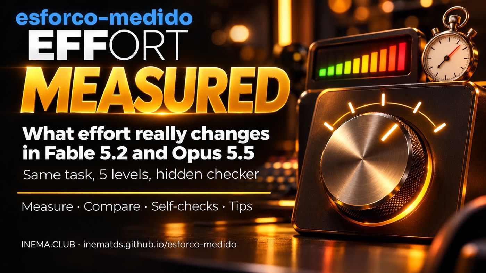

# effort measured

[](https://inematds.github.io/esforco-medido/guia/en/)

**🇧🇷 [Português](README.md) · 🇺🇸 [English](README.en.md) · 🇪🇸 [Español](README.es.md)**

## What it is

effort measured is a free kit that shows, with numbers, what the effort level (`low`, `medium`, `high`, `xhigh`,
`max`) actually changes in **Claude Fable 5.2** and **Claude Opus 5.5**. It runs the same task at each level through
Claude Code on your subscription and reports what the model did: how many tools it called, how many times it checked its
own work, how much it thought, how long it took, and whether it got the answer right, according to a hidden checker the
model never sees. It also includes 14 effort tips, each with a source. Requires Python 3 and Claude Code; no API is used.

## 📖 User guide

Full guide (landing page + step-by-step instructions): **https://inematds.github.io/esforco-medido/guia/en/**

## Why

Effort is not a timer. According to Anthropic's documentation, it controls how much the model thinks **and acts** at each
step ("the level also changes how the model thinks and how many tool calls it makes"). Time is a consequence. And the
same name does not mean the same thing in both models: in the API, Fable 5.2 defaults to `high` and Opus 5.5 to
`medium`, and Opus 5.5's `medium` already exceeds Opus 5's `high`. The way to find out which level works for you is to
measure it on your task.

## What I measured (11/12/2026)

3 coding tasks, each at 5 levels on both models: 30 runs, clean copies, hidden checker, one run per
combination. **All 30 got the maximum score.** What changed was everything else (totals across the 3 tasks):

| | Score | Time | Thinking (tokens) | Checks | Equivalent cost* |
|---|---|---|---|---|---|
| Fable 5.2 · low | 48/48 | 1 min 05 s | 1,015 | 3 | US$ 0,72 |
| Fable 5.2 · high | 48/48 | 1 min 53 s | 3,174 | 7 | US$ 1,05 |
| Fable 5.2 · max | 48/48 | 26 min 42 s | 132,112 | 25 | US$ 9,78 |
| Opus 5.5 · low | 48/48 | 1 min 04 s | 253 | 5 | US$ 0,30 |
| Opus 5.5 · medium | 48/48 | 1 min 29 s | 760 | 4 | US$ 0,39 |
| Opus 5.5 · max | 48/48 | 18 min 06 s | 92,889 | 16 | US$ 3,77 |

Thinking increased at every step; checks grew only slightly through `high` (Fable 3 → 7; Opus barely changed, 5 → 4) and jumped
at `xhigh` and `max` (Fable 25, Opus 16). These are short tasks: they don't show where high effort helps (long work,
open-ended problems). The complete tables, with all 5 levels, are in `exemplos/`.

Repetition (noise): Fable 5.2 on the `carrinho` (shopping cart) task, `low` and `high` three times each → all 12/12; `low` 26–33 s, `high` 39–49 s, and `high` always thought more (more reasoning tokens). The number of tools varied from 3 to 12 across identical runs: compare reasoning and time, not an isolated tool count (`exemplos/carrinho-repeticao/`).

\* Cost calculated by Claude Code using the API pricing table; with a subscription, you pay in usage limits.

## Quick start

```bash
git clone https://github.com/inematds/esforco-medido.git
cd esforco-medido
./medir.sh carrinho -m opus -e low,medium        # 2 quick runs to see it working
./medir.sh calendario                            # fable and opus, low → max (10 runs; max takes a while)
cat dicas/DICAS.md                               # the 14 tips
```

## Contents

| File | What it does |
|---|---|
| `medir.sh` | Runs the task for each `model × effort` combination (`-m fable,opus -e low,…,max -r N`), each run in a clean copy and a temporary HOME: the model can't read your CLAUDE.md, hooks, plugins, skills, or MCP. Only your subscription credentials are connected. `--sem-isolar` runs with everything of yours. |
| `relatorio.py` | Reads each run's stream-json and counts tools (by type), checks (code run to verify, including the test suite), edits, rereads after editing, subagents, errors, thinking tokens, time, equivalent cost, and whether the final response offers to continue instead of finishing. `sessao <arquivo.jsonl>` does the same counts for one of your sessions. |
| `tarefas/` | 3 tasks with a hidden checker (`oculto/checar.py`, score `n/total`): `intervalos` (easy, 16 cases), `carrinho` (find 6 bugs using the rules in a file, 12 cases), `calendario` (5 functions with moving holidays, 20 cases). |
| `dicas/DICAS.md` | 14 effort tips for Fable 5.2 and Opus 5.5, with a source for each (in Portuguese). |
| `dicas/terminar-o-trabalho.en.txt` | Anthropic's "finish the job" block (also in `.pt.txt` and `.es.txt`), to paste into CLAUDE.md when the model stops too soon (original in `.en.txt`). |
| `exemplos/` | Actual runs from this kit (11/12/2026): `RESULTADO.md` and `resultado.json` for each task. |
| `tests/` | 18 tests without network access: `python3 -m unittest discover tests`. |

## Your task

Create `tarefas/<name>/` with `projeto/` (the code the model receives), `pedido.txt` (the request, just as you
would type it), and `oculto/checar.py <folder>` that prints `NOTA n/total`. Run `./medir.sh <name>`.

## The process, start to finish

| # | Step | Command | Who |
|---|---|---|---|
| 1 | Download the kit | `git clone https://github.com/inematds/esforco-medido.git` | 🧠 you |
| 2 | Choose or create a task | `ls tarefas/` or `tarefas/<name>/` | 🧠 you |
| 3 | Measure the levels | `./medir.sh <task> [-m …] [-e …] [-r 3]` | ⚙️ script + 🤖 `claude -p` |
| 4 | Read the results | `resultados/<task>-<date>/RESULTADO.md` | 🧠 you |
| 5 | Set the level | `/effort <level>` or `effortLevel` / `modelSettings` in settings | 🧠 you |
| 6 | If it stops early | Paste `dicas/terminar-o-trabalho.en.txt` into CLAUDE.md | 🧠 you |

## Notes

- Each run uses your subscription limits. `max` can take a long time; start with `-e low,medium,high`.
- A run measures that task on that day. Repeat it (`-r 3`) before making it a rule.
- The cost in the table is what Claude Code calculates using the API pricing table; with a subscription, you pay in usage limits.
- On macOS, login credentials are stored in Keychain: if isolation can't find them, the script warns you and runs without isolation.

## Related kit

[effort right](https://github.com/inematds/esforco-certo): audits which model and effort level each part of your project
runs on, and compares two levels on your own work (`ab.sh`).

## License

MIT.